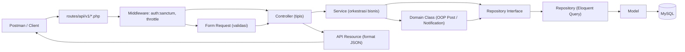
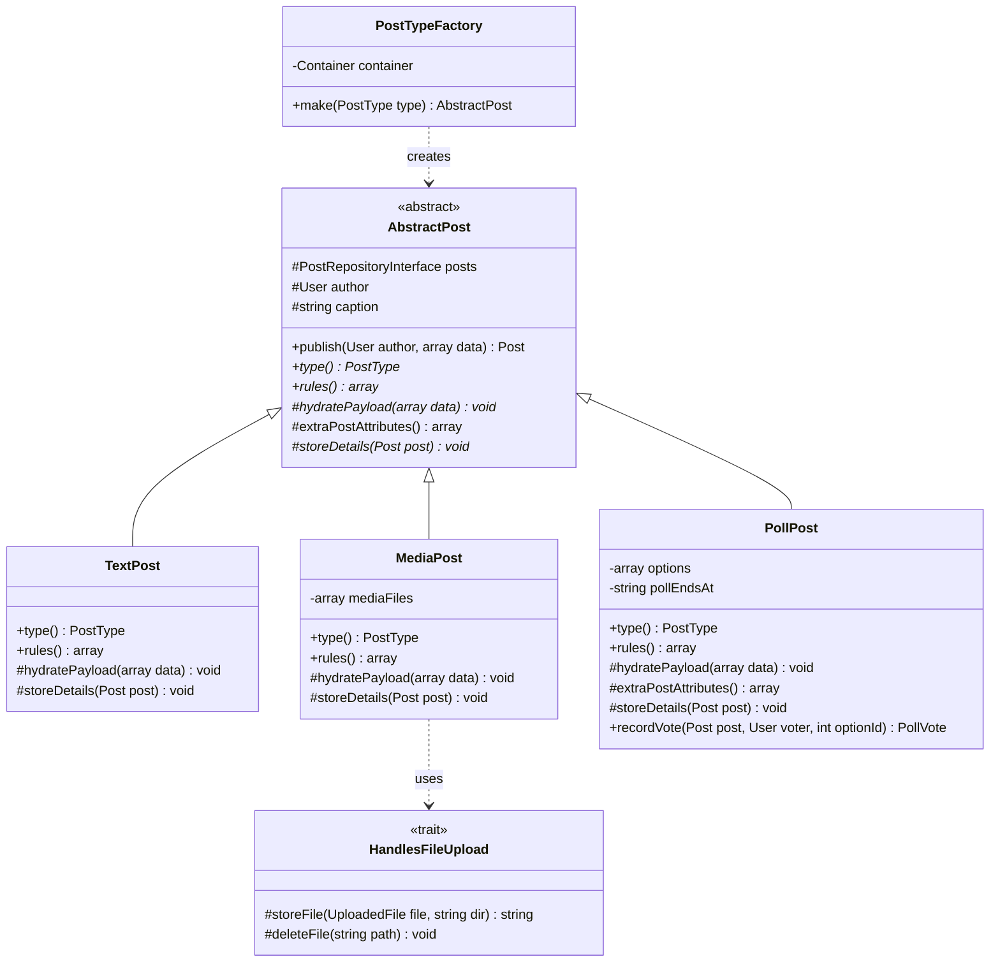
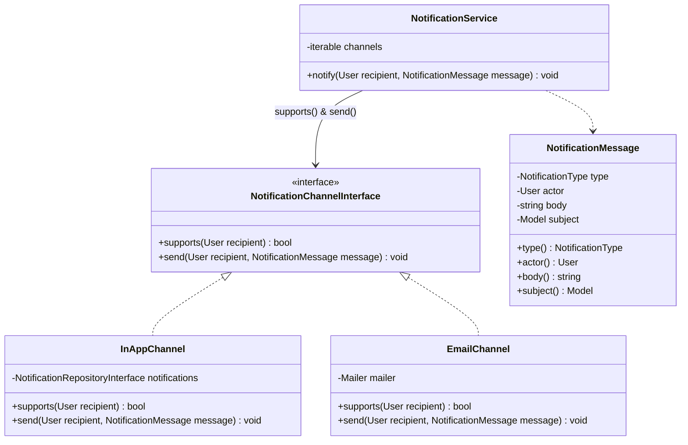
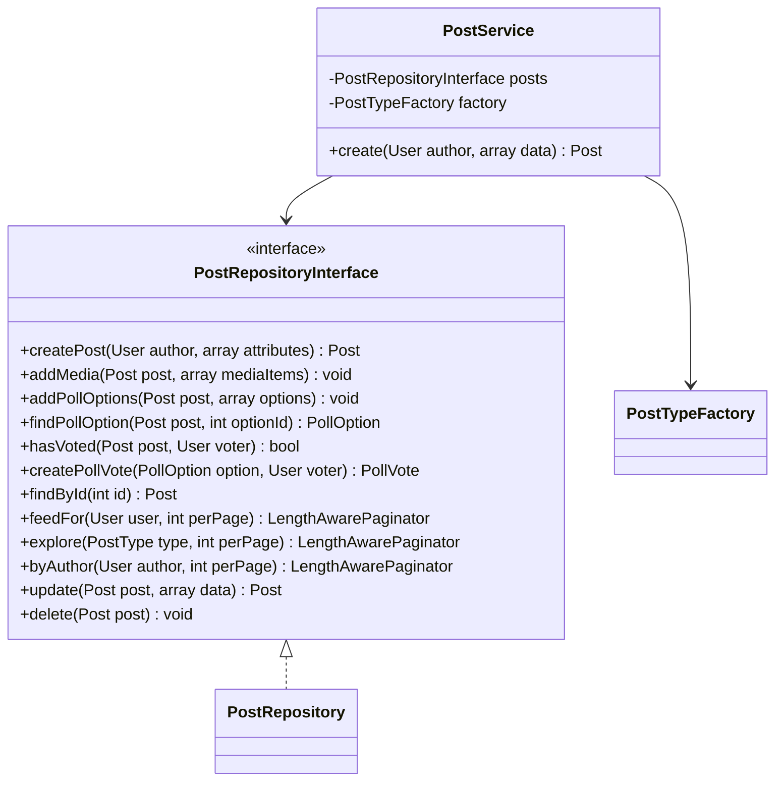
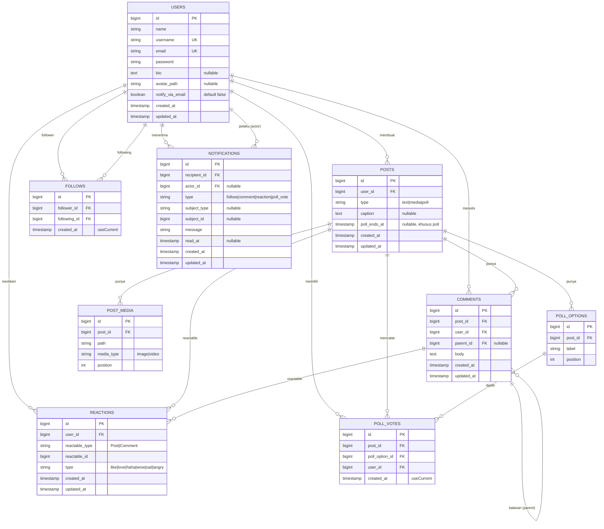
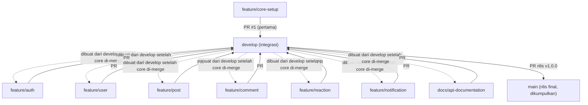
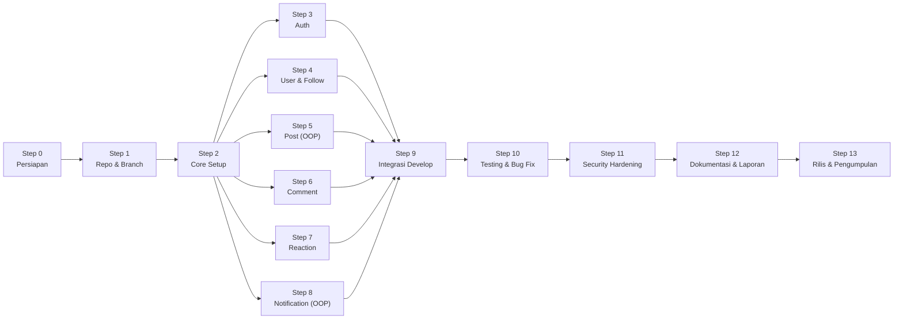

# PRD — Instagram Clone Backend (RESTful API) [v2.0 Final]

> **Kelompok 3 — TUBES PBO & Praktikum (S1 Sistem Informasi, Ganjil 2026/2027)**
> Topik: *Social Media Backend (Instagram/Threads Clone)*
> Dokumen ini adalah **acuan tunggal (Single Source of Truth)** kelompok: apa yang dibangun, bagaimana arsitektur OOP-nya, struktur direktori, pembagian branch tanpa konflik, hingga urutan langkah dari Step 0 sampai selesai.

---

## Daftar Isi

1. [Ringkasan Produk](#1-ringkasan-produk)
2. [Ketentuan Wajib (Checklist Dosen)](#2-ketentuan-wajib-checklist-dosen)
3. [Tech Stack & Versi](#3-tech-stack--versi)
4. [Arsitektur Aplikasi](#4-arsitektur-aplikasi)
5. [Desain OOP (Inti Penilaian 35%)](#5-desain-oop-inti-penilaian-35)
6. [Struktur Direktori Lengkap](#6-struktur-direktori-lengkap)
7. [Desain Database (ERD & Aturan Timestamp)](#7-desain-database-erd--aturan-timestamp)
8. [Daftar Endpoint API](#8-daftar-endpoint-api)
9. [Aturan Bisnis & Validasi](#9-aturan-bisnis--validasi)
10. [Format Response JSON Standar](#10-format-response-json-standar)
11. [Strategi Branch & Pembagian Tugas](#11-strategi-branch--pembagian-tugas)
12. [Aturan Kerja Git (Wajib Dipatuhi)](#12-aturan-kerja-git-wajib-dipatuhi)
13. [Roadmap Step-by-Step (Step 0 → Step Akhir)](#13-roadmap-step-by-step-step-0--step-akhir)
14. [Keamanan & Dependency](#14-keamanan--dependency)
15. [Dokumentasi & Laporan](#15-dokumentasi--laporan)
16. [Definition of Done & Mapping Penilaian](#16-definition-of-done--mapping-penilaian)
17. [Lampiran: Kontrak & Contoh Kode Kunci](#17-lampiran-kontrak--contoh-kode-kunci)

---

## 1. Ringkasan Produk

**Instagram Clone Backend** adalah RESTful API (tanpa frontend) yang menangani:

| Modul | Fungsi Utama |
|---|---|
| **Auth** | Register, login (token Sanctum), logout, cek user login (`me`). Dilindungi *rate limiting*. |
| **User** | Lihat profil sendiri, edit profil + upload avatar, hapus akun, lihat profil publik user lain, follow/unfollow, daftar followers/following. |
| **Post** | Buat/lihat/edit/hapus post 3 tipe: **TextPost**, **MediaPost** (gambar/video), **PollPost** (voting). Feed dari akun yang di-follow & daftar post per user. |
| **Comment** | Komentar & balasan (reply 1 level) pada post, edit & hapus komentar. |
| **Reaction** | Reaksi (`like`, `love`, `haha`, `wow`, `sad`, `angry`) pada **post maupun komentar** (polymorphic). |
| **Notification** | Notifikasi saat ada follow / komentar / reaksi / vote. Dikirim lewat **In-App** dan/atau **Email** dengan satu kontrak method `send()` yang seragam. |

**Entitas utama (sesuai soal):** `User`, `Post`, `Comment`, `Reaction`, `Notification`.
**Entitas pendukung:** `Follow`, `PostMedia`, `PollOption`, `PollVote`.

**Di luar scope:** frontend, chat/DM, story, realtime websocket.

---

## 2. Ketentuan Wajib (Checklist Dosen)

| # | Ketentuan | Cara Kita Memenuhi | Lokasi |
|---|---|---|---|
| 1 | Laravel 13 | Laravel **13.39.0** | `composer.json` |
| 2 | PHP ≥ 8.3.36 / 8.4.27 / 8.5.12 | PHP **8.5.12** | `README.md` |
| 3 | Database MySQL | MySQL (XAMPP) — **bukan SQLite** | `.env`, `.env.example` |
| 4 | Min. 1 Interface | 5 Repository Interface + `NotificationChannelInterface` | `app/Contracts/` |
| 5 | Min. 1 Trait | `ApiResponse`, `HasReactions`, `HandlesFileUpload` | `app/Traits/` |
| 6 | Access modifier tepat | `private readonly` untuk DI, `protected` untuk state & hook turunan, `public` untuk kontrak API kelas | Semua kelas |
| 7 | Inheritance konten post | `AbstractPost` → `TextPost`, `MediaPost`, `PollPost` (mengenkapsulasi state & behavior) | `app/Domain/Posts/` |
| 8 | Polymorphism notifikasi | `InAppChannel` & `EmailChannel` implements `NotificationChannelInterface::send()` | `app/Domain/Notifications/` |
| 9 | CRUD data master | CRUD User (profil), CRUD Post, CRUD Comment | Controller terkait |
| 10 | Auth Sanctum/JWT | **Laravel Sanctum** | `routes/api/v1/auth.php` |
| 11 | Validasi Form Request | Semua input lewat `app/Http/Requests/**` | `app/Http/Requests/` |
| 12 | API Resource | Semua output lewat `app/Http/Resources/**` | `app/Http/Resources/` |
| 13 | Dependency Injection + Service Repository | Controller → Service → Domain → Repository (interface di-*bind*) | `RepositoryServiceProvider` |
| 14 | Versi PHP/Laravel di README | Ditulis di README + screenshot bukti | `README.md`, `docs/evidence/` |
| 15 | `composer audit` bersih | Status: *No security vulnerability advisories found* | `docs/evidence/` |
| 16 | `.env` tidak ter-commit, `APP_DEBUG=false` di produksi | `.env` di `.gitignore`; `.env.example` memuat panduan produksi aman | `.gitignore`, `.env.example` |
| 17 | Rate limiting endpoint auth | `throttle:auth` (5 request/menit per email+IP) | `AppServiceProvider` |
| 18 | Dokumentasi API | Postman Collection publik + JSON di repo | `docs/postman/` |

---

## 3. Tech Stack & Versi

| Komponen | Versi / Tool |
|---|---|
| PHP | 8.5.12 |
| Laravel | 13.39.0 |
| Composer | 2.9.x |
| Database | MySQL / MariaDB (XAMPP) |
| Auth | Laravel Sanctum (via `php artisan install:api`) |
| Storage file | Disk `public` (`php artisan storage:link`) |
| Email (dev) | `MAIL_MAILER=log` → email tercatat di `storage/logs/laravel.log` |
| Testing API | Postman |
| Testing kode | PHPUnit (`php artisan test`) |
| Code style | Laravel Pint (`./vendor/bin/pint`) |

---

## 4. Arsitektur Aplikasi

Alur setiap request **wajib** mengikuti lapisan ini secara konsisten:



**Tanggung jawab tiap lapisan:**

| Lapisan | Boleh | Tidak Boleh |
|---|---|---|
| **Controller** | Terima Form Request, panggil Service, kembalikan Resource via trait `ApiResponse` | Query database langsung, logika bisnis |
| **Form Request** | Aturan validasi & `authorize()` sederhana | Simpan/ubah data |
| **Service** | Orkestrasi bisnis, transaksi DB, memicu notifikasi | Mengembalikan JSON Response |
| **Domain** | Enkapsulasi state & perilaku OOP (inheritance/polymorphism), memanggil Repository Interface | Akses `Request` HTTP atau mem-bypass Repository |
| **Repository** | Semua query Eloquent (`find`, `paginate`, `create`, `update`, `delete`) | Logika bisnis / pengiriman email |
| **Model** | Relasi Eloquent, `$fillable`, `casts()`, `$timestamps` | Logika bisnis berat |
| **Resource** | Mengubah Model → struktur array JSON seragam | Query database tambahan (wajib mengandalkan eager load) |
| **Policy** | Cek otorisasi kepemilikan (hanya pemilik boleh edit/hapus) | — |

---

## 5. Desain OOP (Inti Penilaian 35%)

### 5.1 Inheritance & Encapsulation — Konten Post

> **Catatan Desain:** Nama class domain dibuat `AbstractPost` (atau dapat di-alias dari `Post`) untuk membedakannya dari Eloquent Model `App\Models\Post`. Model `Post` bertugas sebagai *persistence model* (tabel database), sedangkan `AbstractPost` beserta ketiga turunannya mengenkapsulasi **atribut/state** dan **perilaku/behavior** spesifik tiap jenis postingan.



- **`AbstractPost`** menyimpan state dasar (`protected User $author`, `protected ?string $caption`) dan menerapkan **Template Method Pattern** pada `final public function publish()`:
  1. Mengisi state dasar & memanggil `hydratePayload($data)` milik subclass.
  2. Menyimpan record utama `Post` melalui `PostRepositoryInterface::createPost()` dengan atribut tambahan dari `extraPostAttributes()`.
  3. Memanggil hook `storeDetails(Post $post)` yang di-override oleh setiap subclass.
- **`TextPost`** → hanya mengizinkan `caption` (wajib) dan menolak input `media` atau `options`.
- **`MediaPost`** → mengenkapsulasi `private array $mediaFiles = []`, memvalidasi gambar/video, mengunggah file via trait `HandlesFileUpload`, dan menyimpan detailnya lewat `PostRepositoryInterface`.
- **`PollPost`** → mengenkapsulasi `private array $options = []` dan `private ?string $pollEndsAt = null`, meng-override `extraPostAttributes()` untuk menyimpan `poll_ends_at`, serta menyediakan method `recordVote()` untuk **pencatatan voting** sesuai aturan bisnis.
- **`PostTypeFactory`** → memilih subclass yang tepat berdasarkan enum `PostType` (Service tidak perlu `if/else` tipe post).

### 5.2 Polymorphism — Notifikasi



- `NotificationService` menerima injeksi `iterable<NotificationChannelInterface>` melalui *Tagged Binding* di `RepositoryServiceProvider` (**murni bergantung pada Interface, bukan class konkret**).
- Saat `notify()` dipanggil, `NotificationService` melakukan iterasi ke seluruh channel dan memanggil `$channel->send($recipient, $message)` apabila `$channel->supports($recipient)` bernilai `true` → **Polymorphism murni**.
- `InAppChannel` → menyimpan notifikasi ke tabel `notifications`.
- `EmailChannel` → aktif jika `$recipient->notify_via_email === true`, mengirim `NotificationMail` (pada environment dev tercatat di `storage/logs/laravel.log`).

### 5.3 Interface — Repository Pattern



Seluruh 5 Repository Interface berada di `app/Contracts/Repositories/`:
- `UserRepositoryInterface`
- `PostRepositoryInterface`
- `CommentRepositoryInterface`
- `ReactionRepositoryInterface`
- `NotificationRepositoryInterface`

Semuanya di-*bind* ke implementasi konkretnya di `app/Providers/RepositoryServiceProvider.php` (lihat kontrak lengkapnya di **Lampiran 17.5**).

### 5.4 Trait (Reusable Code)

| Trait | Dipakai Oleh | Fungsi & Method |
|---|---|---|
| `ApiResponse` | `Controller` (base) → seluruh controller | `success()`, `created()`, `error()`, `paginated()` |
| `HasReactions` | Model `Post` & `Comment` | Relasi `reactions()` (`morphMany`), `reactionSummary()`, `isReactedBy(User)` |
| `HandlesFileUpload` | `MediaPost`, `ProfileService` (avatar) | `storeFile(UploadedFile $file, string $dir)`, `deleteFile(?string $path)` |

### 5.5 Encapsulation & Access Modifier (Pedoman)

| Modifier | Gunakan Untuk | Contoh |
|---|---|---|
| `private readonly` | Dependency yang di-*inject* lewat constructor & properti Value Object | `private readonly PostRepositoryInterface $posts` |
| `private` | State spesifik subclass atau helper internal | `private array $options = []` di `PollPost` |
| `protected` | State warisan & method hook yang **wajib/boleh** diakses/di-override turunan | `protected User $author`, `AbstractPost::storeDetails()`, `$fillable` |
| `public` | Kontrak method yang dipanggil dari luar kelas | `publish()`, `send()`, `notify()` |
| `final` | Kelas daun (*leaf class*) atau Template Method yang tidak boleh diubah alurnya | `final class PollPost`, `final public function publish()` |

### 5.6 Enum (PHP 8.1+)

| Enum | Nilai Backing (`string`) |
|---|---|
| `PostType` | `text`, `media`, `poll` |
| `MediaType` | `image`, `video` |
| `ReactionType` | `like`, `love`, `haha`, `wow`, `sad`, `angry` |
| `NotificationType` | `follow`, `comment`, `reaction`, `poll_vote` |

---

## 6. Struktur Direktori Lengkap

Keterangan pemilik file: **`[CORE]`** = dibuat di `feature/core-setup` · **`[AUTH]`** · **`[USER]`** · **`[POST]`** · **`[COMMENT]`** · **`[REACTION]`** · **`[NOTIF]`** · **`[DOCS]`**.

> [!IMPORTANT]
> Di **Step 2 (`feature/core-setup`)**, Ketua membuat:
> 1. **Seluruh Migration, Model, Factory, Enum, dan Interface** secara **lengkap & siap pakai**.
> 2. **Seluruh file Controller, Request, Resource, Service, Repository, Domain, Policy, Seeder, dan Test** sebagai **kerangka kosong (skeleton)** yang valid secara sintaks PHP.
>
> Setelah `feature/core-setup` di-merge ke `develop`, setiap anggota **tinggal mengisi kode** pada file milik modulnya di branch masing-masing tanpa saling menunggu dan tanpa konflik merge.

```text
TUBES-PPBO-K3/
├── app/
│   ├── Contracts/                                   # SEMUA INTERFACE (DIBUAT PENUH DI CORE)
│   │   ├── Notifications/
│   │   │   └── NotificationChannelInterface.php     [CORE]
│   │   └── Repositories/
│   │       ├── UserRepositoryInterface.php          [CORE]
│   │       ├── PostRepositoryInterface.php          [CORE]
│   │       ├── CommentRepositoryInterface.php       [CORE]
│   │       ├── ReactionRepositoryInterface.php      [CORE]
│   │       └── NotificationRepositoryInterface.php  [CORE]
│   │
│   ├── Domain/                                      # LOGIKA OOP MURNI
│   │   ├── Posts/
│   │   │   ├── AbstractPost.php                     [POST]  abstract class
│   │   │   ├── TextPost.php                         [POST]  extends AbstractPost
│   │   │   ├── MediaPost.php                        [POST]  extends AbstractPost
│   │   │   ├── PollPost.php                         [POST]  extends AbstractPost
│   │   │   └── PostTypeFactory.php                  [POST]
│   │   └── Notifications/
│   │       ├── Channels/
│   │       │   ├── InAppChannel.php                 [CORE no-op → NOTIF] implements interface
│   │       │   └── EmailChannel.php                 [CORE no-op → NOTIF] implements interface
│   │       └── NotificationMessage.php              [CORE]  value object (siap pakai sejak CORE)
│   │
│   ├── Enums/                                       # DIBUAT PENUH DI CORE
│   │   ├── PostType.php                             [CORE]
│   │   ├── MediaType.php                            [CORE]
│   │   ├── ReactionType.php                         [CORE]
│   │   └── NotificationType.php                     [CORE]
│   │
│   ├── Exceptions/
│   │   └── BusinessRuleException.php                [CORE]  dirender JSON 422
│   │
│   ├── Http/
│   │   ├── Controllers/
│   │   │   ├── Controller.php                       [CORE]  use ApiResponse
│   │   │   └── Api/
│   │   │       └── V1/
│   │   │           ├── Auth/
│   │   │           │   ├── RegisterController.php   [AUTH]  invokable
│   │   │           │   ├── LoginController.php      [AUTH]  invokable
│   │   │           │   ├── LogoutController.php     [AUTH]  invokable
│   │   │           │   └── MeController.php         [AUTH]  invokable
│   │   │           ├── User/
│   │   │           │   ├── ProfileController.php    [USER]  show/update/destroy profil sendiri
│   │   │           │   ├── UserController.php       [USER]  lihat profil publik user lain
│   │   │           │   └── FollowController.php     [USER]  follow/unfollow/followers/following
│   │   │           ├── Post/
│   │   │           │   ├── PostController.php       [POST]  CRUD post + byAuthor (post per user)
│   │   │           │   ├── FeedController.php       [POST]  feed timeline
│   │   │           │   └── PollVoteController.php   [POST]  voting poll
│   │   │           ├── Comment/
│   │   │           │   └── CommentController.php    [COMMENT]
│   │   │           ├── Reaction/
│   │   │           │   ├── PostReactionController.php     [REACTION]
│   │   │           │   └── CommentReactionController.php  [REACTION]
│   │   │           └── Notification/
│   │   │               └── NotificationController.php     [NOTIF]
│   │   │
│   │   ├── Requests/
│   │   │   ├── Auth/
│   │   │   │   ├── RegisterRequest.php              [AUTH]
│   │   │   │   └── LoginRequest.php                 [AUTH]
│   │   │   ├── User/
│   │   │   │   ├── UpdateProfileRequest.php         [USER]
│   │   │   │   └── DeleteAccountRequest.php         [USER]
│   │   │   ├── Post/
│   │   │   │   ├── StorePostRequest.php             [POST]
│   │   │   │   ├── UpdatePostRequest.php            [POST]
│   │   │   │   └── VotePollRequest.php              [POST]
│   │   │   ├── Comment/
│   │   │   │   ├── StoreCommentRequest.php          [COMMENT]
│   │   │   │   └── UpdateCommentRequest.php         [COMMENT]
│   │   │   └── Reaction/
│   │   │       └── StoreReactionRequest.php         [REACTION]
│   │   │
│   │   └── Resources/
│   │       ├── Auth/
│   │       │   └── AuthTokenResource.php            [AUTH]
│   │       ├── User/
│   │       │   ├── UserResource.php                 [CORE → USER] dipakai lintas modul
│   │       │   └── ProfileResource.php              [USER]  data milik sendiri (+email)
│   │       ├── Post/
│   │       │   ├── PostResource.php                 [POST]
│   │       │   ├── PostMediaResource.php            [POST]
│   │       │   └── PollOptionResource.php           [POST]
│   │       ├── Comment/
│   │       │   └── CommentResource.php              [COMMENT]
│   │       ├── Reaction/
│   │       │   └── ReactionResource.php             [REACTION]
│   │       └── Notification/
│   │           └── NotificationResource.php         [NOTIF]
│   │
│   ├── Mail/
│   │   └── NotificationMail.php                     [NOTIF]
│   │
│   ├── Models/                                      # SEMUA MODEL + RELASI DIBUAT PENUH DI CORE
│   │   ├── User.php                                 [CORE]  HasApiTokens
│   │   ├── Follow.php                               [CORE]  public $timestamps = false
│   │   ├── Post.php                                 [CORE]  use HasReactions
│   │   ├── PostMedia.php                            [CORE]  public $timestamps = false
│   │   ├── PollOption.php                           [CORE]  public $timestamps = false
│   │   ├── PollVote.php                             [CORE]  public $timestamps = false
│   │   ├── Comment.php                              [CORE]  use HasReactions
│   │   ├── Reaction.php                             [CORE]  morphTo reactable
│   │   └── Notification.php                         [CORE]
│   │
│   ├── Policies/
│   │   ├── PostPolicy.php                           [POST]
│   │   └── CommentPolicy.php                        [COMMENT]
│   │
│   ├── Providers/
│   │   ├── AppServiceProvider.php                   [CORE]  RateLimiter
│   │   └── RepositoryServiceProvider.php            [CORE]  bind interface → repository & channel tag
│   │
│   ├── Repositories/
│   │   ├── UserRepository.php                       [USER]
│   │   ├── PostRepository.php                       [POST]
│   │   ├── CommentRepository.php                    [COMMENT]
│   │   ├── ReactionRepository.php                   [REACTION]
│   │   └── NotificationRepository.php               [NOTIF]
│   │
│   ├── Services/
│   │   ├── Auth/
│   │   │   └── AuthService.php                      [AUTH]
│   │   ├── User/
│   │   │   ├── ProfileService.php                   [USER]
│   │   │   └── FollowService.php                    [USER]
│   │   ├── Post/
│   │   │   ├── PostService.php                      [POST]
│   │   │   ├── FeedService.php                      [POST]
│   │   │   └── PollVoteService.php                  [POST]
│   │   ├── Comment/
│   │   │   └── CommentService.php                   [COMMENT]
│   │   ├── Reaction/
│   │   │   └── ReactionService.php                  [REACTION]
│   │   └── Notification/
│   │       └── NotificationService.php              [CORE → NOTIF]
│   │
│   └── Traits/
│       ├── ApiResponse.php                          [CORE]  diisi penuh sejak CORE
│       ├── HasReactions.php                         [CORE → REACTION]
│       └── HandlesFileUpload.php                    [CORE]  diisi penuh sejak CORE (dipakai USER & POST)
│
├── bootstrap/
│   ├── app.php                                      [CORE]  api routing + exception JSON standar
│   └── providers.php                                [CORE]  + RepositoryServiceProvider
│
├── database/
│   ├── factories/                                   # SEMUA FACTORY DIBUAT DI CORE AGAR TEST MANDIRI
│   │   ├── UserFactory.php                          [CORE]
│   │   ├── PostFactory.php                          [CORE]
│   │   └── CommentFactory.php                       [CORE]
│   ├── migrations/                                  # SEMUA MIGRATION DIBUAT DI CORE (URUTAN FK AMAN)
│   │   ├── 0001_01_01_000000_create_users_table.php
│   │   ├── 0001_01_01_000001_create_cache_table.php
│   │   ├── 0001_01_01_000002_create_jobs_table.php
│   │   ├── xxxx_create_personal_access_tokens_table.php
│   │   ├── 2026_11_10_000001_create_follows_table.php
│   │   ├── 2026_11_10_000002_create_posts_table.php
│   │   ├── 2026_11_10_000003_create_post_media_table.php
│   │   ├── 2026_11_10_000004_create_poll_options_table.php
│   │   ├── 2026_11_10_000005_create_poll_votes_table.php
│   │   ├── 2026_11_10_000006_create_comments_table.php
│   │   ├── 2026_11_10_000007_create_reactions_table.php
│   │   └── 2026_11_10_000008_create_notifications_table.php
│   └── seeders/                                     # DIPISAH PER MODUL (BEBAS KONFLIK MERGE)
│       ├── DatabaseSeeder.php                       [CORE]  memanggil 4 seeder di bawah
│       ├── UserSeeder.php                           [USER]
│       ├── PostSeeder.php                           [POST]
│       ├── CommentSeeder.php                        [COMMENT]
│       └── ReactionSeeder.php                       [REACTION]
│
├── resources/views/emails/
│   └── notification.blade.php                       [NOTIF]  template email
│
├── routes/
│   ├── api.php                                      [CORE]  hanya me-require file v1
│   ├── api/v1/
│   │   ├── auth.php                                 [AUTH]
│   │   ├── users.php                                [USER]
│   │   ├── posts.php                                [POST]
│   │   ├── comments.php                             [COMMENT]
│   │   ├── reactions.php                            [REACTION]
│   │   └── notifications.php                        [NOTIF]
│   ├── console.php
│   └── web.php
│
├── tests/Feature/
│   ├── Auth/AuthTest.php                            [AUTH]
│   ├── User/ProfileTest.php, FollowTest.php         [USER]
│   ├── Post/PostTest.php, PollVoteTest.php          [POST]
│   ├── Comment/CommentTest.php                      [COMMENT]
│   ├── Reaction/ReactionTest.php                    [REACTION]
│   └── Notification/NotificationTest.php            [NOTIF]
│
├── docs/                                            [DOCS]
│   ├── postman/TUBES-PPBO-K3.postman_collection.json
│   ├── postman/TUBES-PPBO-K3.postman_environment.json
│   ├── diagrams/class-diagram.png
│   ├── diagrams/erd.png
│   ├── evidence/php-version.png
│   ├── evidence/laravel-version.png
│   ├── evidence/composer-audit.png
│   └── report/Laporan-Teknis-Kelompok3.pdf
│
├── .github/pull_request_template.md                 [CORE]
├── .env.example                                     [CORE]
├── PRD.md                                           (dokumen ini)
└── README.md                                        [DOCS]
```

> [!TIP]
> **Mengapa `HandlesFileUpload`, `UserResource` dasar, dan semua `Factory` diisi penuh di `[CORE]`?**
> - `HandlesFileUpload` dipakai bersama oleh `ProfileService` (`feature/user`) dan `MediaPost` (`feature/post`).
> - `UserResource` dipakai di dalam `PostResource`, `CommentResource`, dan `NotificationResource` untuk menampilkan ringkasan `author`/`actor`.
> - `UserFactory`, `PostFactory`, dan `CommentFactory` dibutuhkan oleh semua anggota saat menulis *Feature Test* di branch masing-masing.
> Dengan menyiapkannya di `[CORE]`, setiap branch fitur dapat berjalan dan diuji **100% secara mandiri**.

---

## 7. Desain Database (ERD & Aturan Timestamp)



### Aturan Timestamp & Constraint Penting (Pencegahan Error 500)

| Tabel / Model | Aturan Wajib di Migration & Model |
|---|---|
| `users`, `posts`, `comments`, `reactions`, `notifications` | Gunakan `$table->timestamps();` di migration. Model menggunakan default `$timestamps = true`. |
| `post_media`, `poll_options` | Tidak memiliki kolom timestamp. **Wajib** tambahkan `public $timestamps = false;` pada Model `PostMedia` dan `PollOption`. |
| `follows`, `poll_votes` | Gunakan `$table->timestamp('created_at')->useCurrent();` di migration. **Wajib** tambahkan `public $timestamps = false;` pada Model `Follow` dan `PollVote` agar Eloquent tidak mencari kolom `updated_at`. |
| `follows` | `unique(['follower_id', 'following_id'])`, FK `cascadeOnDelete()`. |
| `poll_votes` | `unique(['post_id', 'user_id'])` → 1 user hanya boleh 1 vote per poll. |
| `reactions` | `unique(['user_id', 'reactable_type', 'reactable_id'])` → 1 user 1 reaksi per objek. |
| `posts` | Index `['user_id', 'created_at']` untuk performa query feed. |
| `notifications` | Index `['recipient_id', 'read_at']`. |

> [!WARNING]
> Kita membuat tabel `notifications` **sendiri** sesuai skema di atas (bukan `php artisan make:notifications-table` bawaan Laravel). Jangan menjalankan perintah bawaan itu agar tidak bentrok nama tabel.

---

## 8. Daftar Endpoint API

Base URL: `http://127.0.0.1:8000/api/v1` · Header wajib: `Accept: application/json` · Endpoint 🔒 butuh `Authorization: Bearer {token}`.

### 8.1 Auth — `routes/api/v1/auth.php` (branch `feature/auth`)

| Method | Endpoint | Keterangan | Proteksi |
|---|---|---|---|
| POST | `/auth/register` | Daftar akun baru, kembalikan token Sanctum | `throttle:auth` |
| POST | `/auth/login` | Login, kembalikan token Sanctum | `throttle:auth` |
| POST | `/auth/logout` | Hapus token aktif (`currentAccessToken`) | 🔒 |
| GET | `/auth/me` | Data user yang sedang login | 🔒 |

### 8.2 User & Follow — `routes/api/v1/users.php` (branch `feature/user`)

| Method | Endpoint | Keterangan |
|---|---|---|
| GET | `/profile` | 🔒 Lihat profil sendiri (`ProfileResource`) |
| PUT / POST | `/profile` | 🔒 Update profil (`name`, `username`, `bio`, `avatar`, `notify_via_email`). Mendukung `PUT` (JSON) maupun `POST /profile` (atau `_method=PUT`) untuk upload `multipart/form-data` avatar |
| DELETE | `/profile` | 🔒 Hapus akun sendiri (wajib konfirmasi `password`) |
| GET | `/users/{user:username}` | 🔒 Profil publik user lain + jumlah post/followers/following |
| POST | `/users/{user:username}/follow` | 🔒 Follow user |
| DELETE | `/users/{user:username}/follow` | 🔒 Unfollow user |
| GET | `/users/{user:username}/followers` | 🔒 Daftar followers (paginate) |
| GET | `/users/{user:username}/following` | 🔒 Daftar following (paginate) |

### 8.3 Post — `routes/api/v1/posts.php` (branch `feature/post`)

| Method | Endpoint | Keterangan |
|---|---|---|
| GET | `/feed` | 🔒 Post dari diri sendiri + akun yang di-follow (terbaru, paginate) |
| GET | `/posts` | 🔒 Explore: semua post terbaru (paginate, filter opsional `?type=media`) |
| GET | `/users/{user:username}/posts` | 🔒 Daftar post milik user tertentu (`PostController@byAuthor`, paginate) |
| POST | `/posts` | 🔒 Buat post (`type` = `text` / `media` / `poll`) |
| GET | `/posts/{post}` | 🔒 Detail post |
| PATCH | `/posts/{post}` | 🔒 Edit caption (hanya pemilik via `PostPolicy`) |
| DELETE | `/posts/{post}` | 🔒 Hapus post + file media (hanya pemilik via `PostPolicy`) |
| POST | `/posts/{post}/votes` | 🔒 Vote polling (`poll_option_id`) |

### 8.4 Comment — `routes/api/v1/comments.php` (branch `feature/comment`)

| Method | Endpoint | Keterangan |
|---|---|---|
| GET | `/posts/{post}/comments` | 🔒 Daftar komentar utama beserta `replies` (paginate) |
| POST | `/posts/{post}/comments` | 🔒 Tambah komentar / reply (`parent_id` opsional) |
| PATCH | `/comments/{comment}` | 🔒 Edit komentar (hanya pemilik komentar) |
| DELETE | `/comments/{comment}` | 🔒 Hapus komentar (pemilik komentar **atau** pemilik post) |

### 8.5 Reaction — `routes/api/v1/reactions.php` (branch `feature/reaction`)

| Method | Endpoint | Keterangan |
|---|---|---|
| GET | `/posts/{post}/reactions` | 🔒 Daftar & ringkasan reaksi pada post |
| PUT | `/posts/{post}/reactions` | 🔒 Beri/ganti reaksi pada post (`type`) — *upsert* |
| DELETE | `/posts/{post}/reactions` | 🔒 Hapus reaksi sendiri pada post |
| GET | `/comments/{comment}/reactions` | 🔒 Daftar reaksi pada komentar |
| PUT | `/comments/{comment}/reactions` | 🔒 Beri/ganti reaksi pada komentar (`type`) — *upsert* |
| DELETE | `/comments/{comment}/reactions` | 🔒 Hapus reaksi sendiri pada komentar |

### 8.6 Notification — `routes/api/v1/notifications.php` (branch `feature/notification`)

| Method | Endpoint | Keterangan |
|---|---|---|
| GET | `/notifications` | 🔒 Daftar notifikasi milik user login (filter opsional `?unread=1`) |
| GET | `/notifications/unread-count` | 🔒 Jumlah notifikasi yang belum dibaca |
| PATCH | `/notifications/{notification}/read` | 🔒 Tandai 1 notifikasi sudah dibaca |
| PATCH | `/notifications/read-all` | 🔒 Tandai semua notifikasi sudah dibaca |
| DELETE | `/notifications/{notification}` | 🔒 Hapus notifikasi milik sendiri |

**Total: 33 endpoint.**

---

## 9. Aturan Bisnis & Validasi

### 9.1 Validasi (Form Request)

| Request | Aturan Validasi |
|---|---|
| `RegisterRequest` | `name`: `required\|string\|max:100` · `username`: `required\|alpha_dash\|min:3\|max:30\|unique:users,username` · `email`: `required\|email\|unique:users,email` · `password`: `required\|string\|confirmed\|min:8` |
| `LoginRequest` | `email`: `required\|email` · `password`: `required\|string` |
| `UpdateProfileRequest` | `name`: `sometimes\|string\|max:100` · `username`: `sometimes\|alpha_dash\|min:3\|max:30\| Rule::unique('users')->ignore($this->user()->id)` · `bio`: `nullable\|string\|max:150` · `avatar`: `nullable\|image\|mimes:jpg,jpeg,png,webp\|max:2048` · `notify_via_email`: `sometimes\|boolean` |
| `DeleteAccountRequest` | `password`: `['required', 'string', 'current_password']` *(tanpa `:sanctum` agar kompatibel penuh dengan Sanctum maupun PHPUnit `actingAs`)* |
| `StorePostRequest` | `type`: `['required', Rule::enum(PostType::class)]` + **aturan dinamis dari `AbstractPost::rules()` sesuai tipe**: |
| ↳ `TextPost::rules()` | `caption`: `required\|string\|max:2200` · `media`: `prohibited` · `options`: `prohibited` · `poll_ends_at`: `prohibited` |
| ↳ `MediaPost::rules()` | `caption`: `nullable\|string\|max:2200` · `media`: `required\|array\|min:1\|max:10` · `media.*`: `file\|mimetypes:image/jpeg,image/png,image/webp,video/mp4,video/quicktime\|max:51200` · `options`: `prohibited` · `poll_ends_at`: `prohibited` |
| ↳ `PollPost::rules()` | `caption`: `required\|string\|max:2200` · `options`: `required\|array\|min:2\|max:4` · `options.*`: `required\|string\|distinct\|max:50` · `poll_ends_at`: `nullable\|date\|after:now` · `media`: `prohibited` |
| `UpdatePostRequest` | `caption`: `required\|string\|max:2200` |
| `VotePollRequest` | `poll_option_id`: `required\|integer\|exists:poll_options,id` |
| `StoreCommentRequest` | `body`: `required\|string\|max:1000` · `parent_id`: `nullable\|integer\|exists:comments,id` |
| `UpdateCommentRequest` | `body`: `required\|string\|max:1000` |
| `StoreReactionRequest` | `type`: `['required', Rule::enum(ReactionType::class)]` |

### 9.2 Aturan Bisnis

| Kode | Aturan | Respon Bila Dilanggar |
|---|---|---|
| BR-01 | Hanya pemilik yang boleh edit/hapus post & komentar (`PostPolicy`, `CommentPolicy`). Pemilik post juga berhak menghapus komentar di post miliknya. | `403 Forbidden` |
| BR-02 | Tipe post (`type`) **tidak bisa diubah** setelah dibuat; yang bisa diedit hanya `caption`. | — |
| BR-03 | Vote hanya berlaku untuk post bertipe `poll`, dan `poll_option_id` harus milik post tersebut (`BusinessRuleException`). | `422 Unprocessable Content` |
| BR-04 | 1 user hanya boleh vote 1x per poll; tidak boleh vote jika `poll_ends_at` sudah lewat (`BusinessRuleException`). | `422 Unprocessable Content` |
| BR-05 | Tidak boleh follow diri sendiri (`BusinessRuleException`); follow user yang sudah di-follow bersifat idempotent. | `422 Unprocessable Content` |
| BR-06 | 1 user maksimal 1 reaksi per post/komentar; mengirim reaksi baru akan mengganti `type` reaksi lama (*upsert*). | — |
| BR-07 | `parent_id` reply harus berada pada `post_id` yang sama (`BusinessRuleException`); reply maksimal 1 level (jika me-reply sub-komentar, otomatis ditempel ke `parent_id` utamanya). | `422 Unprocessable Content` |
| BR-08 | Notifikasi **tidak dikirim** jika pelaku sama dengan penerima (`$recipient->is($message->actor())`). | — |
| BR-09 | Notifikasi `InAppChannel` selalu dikirim; `EmailChannel` hanya dikirim bila `$recipient->notify_via_email === true`. | — |
| BR-10 | Hapus post → hapus semua file media dari disk `public`. Hapus akun → hapus file avatar & seluruh token Sanctum. | — |
| BR-11 | Response JSON user **tidak pernah** menampilkan `password` atau `remember_token`; `email` hanya tampil di `ProfileResource` & `AuthTokenResource`. | — |

### 9.3 Pemicu Notifikasi

| Kejadian | Dipicu di Service | Penerima | Contoh Pesan |
|---|---|---|---|
| Follow | `FollowService::follow()` | User yang di-follow | `"{username} mulai mengikuti kamu."` |
| Komentar baru | `CommentService::create()` | Pemilik post (atau pemilik komentar induk jika reply) | `"{username} mengomentari postinganmu."` |
| Reaksi | `ReactionService::react()` | Pemilik post / komentar | `"{username} memberi reaksi pada postinganmu."` |
| Vote polling | `PollVoteService::vote()` | Pemilik poll | `"{username} memberikan suara pada polling-mu."` |

---

## 10. Format Response JSON Standar

Semua response dikembalikan melalui trait `ApiResponse` + API Resource + konfigurasi exception di `bootstrap/app.php`.

**Sukses (single — 200 / 201):**
```json
{
  "success": true,
  "message": "Post berhasil dibuat.",
  "data": {
    "id": 1,
    "type": "poll",
    "caption": "Pilih framework favorit?",
    "author": {
      "id": 3,
      "name": "Budi Santoso",
      "username": "budi",
      "avatar_url": null
    },
    "poll": {
      "ends_at": null,
      "total_votes": 0,
      "my_vote_option_id": null,
      "options": [
        { "id": 1, "label": "Laravel", "votes_count": 0 },
        { "id": 2, "label": "Symfony", "votes_count": 0 }
      ]
    },
    "reactions_count": 0,
    "comments_count": 0,
    "created_at": "2026-11-12T10:00:00+07:00"
  }
}
```

**Sukses (paginate — 200):**
```json
{
  "success": true,
  "message": "Feed berhasil diambil.",
  "data": [ { "id": 1 } ],
  "links": { "first": "...", "last": "...", "prev": null, "next": "..." },
  "meta": { "current_page": 1, "per_page": 15, "total": 42 }
}
```

**Gagal Validasi / Business Rule (422):**
```json
{
  "success": false,
  "message": "Data yang dikirim tidak valid.",
  "errors": {
    "options": ["The options field must have at least 2 items."]
  }
}
```

| HTTP Code | Kapan Digunakan |
|---|---|
| `200` | Berhasil mengambil, mengubah, atau menghapus data |
| `201` | Berhasil membuat resource baru (register, post, komentar, vote) |
| `401` | Belum login / token tidak valid / kredensial login salah |
| `403` | Akses ditolak oleh Policy / bukan pemilik resource |
| `404` | Resource / endpoint tidak ditemukan |
| `422` | Validasi Form Request gagal atau `BusinessRuleException` |
| `429` | Terkena batas Rate Limiting (`throttle:auth` / `throttle:api`) |
| **`500`** | **DILARANG TERJADI** (semua potensi error harus tertangkap dengan bersih) |

---

## 11. Strategi Branch & Pembagian Tugas

### 11.1 Alur Branch Git



### 11.2 Daftar Branch (1 Branch = 1 Kategori Fungsi, Terisolasi Penuh)

| Branch | Kategori | Lingkup File yang Dikerjakan | Bergantung Pada |
|---|---|---|---|
| `main` | Rilis Final | Kode final yang siap dikumpulkan. **Dilarang push langsung.** | `develop` |
| `develop` | Integrasi | Cabang integrasi semua fitur yang sudah lolos PR review. | — |
| `feature/core-setup` | Fondasi & Skeleton | Konfigurasi MySQL & Sanctum, seluruh Migration, Model, Factory, Enum, Interface, Trait (`ApiResponse`, `HandlesFileUpload`), `UserResource` dasar, `NotificationMessage`, skeleton seluruh file modul, route loader, exception handler JSON. | — |
| `feature/auth` | Autentikasi | Register, Login, Logout, Me, Rate Limit test (`app/*/Auth/*`, `routes/api/v1/auth.php`). | `feature/core-setup` |
| `feature/user` | User & Follow | CRUD Profil, Upload Avatar, Follow/Unfollow, Followers/Following, `UserSeeder` (`app/*/User/*`, `routes/api/v1/users.php`). | `feature/core-setup` |
| `feature/post` | Post (Inheritance OOP) | `AbstractPost` + `TextPost`, `MediaPost`, `PollPost`, `PostTypeFactory`, CRUD Post, `byAuthor`, Feed, Poll Vote, `PostPolicy`, `PostSeeder` (`app/Domain/Posts/*`, `app/*/Post/*`, `routes/api/v1/posts.php`). | `feature/core-setup` |
| `feature/comment` | Komentar | CRUD Komentar + Reply 1 level, `CommentPolicy`, `CommentSeeder` (`app/*/Comment/*`, `routes/api/v1/comments.php`). | `feature/core-setup` |
| `feature/reaction` | Reaksi (Polymorphic) | Melengkapi trait `HasReactions`, Upsert/Remove Reaksi pada Post & Komentar, `ReactionSeeder` (`app/*/Reaction/*`, `routes/api/v1/reactions.php`). | `feature/core-setup` |
| `feature/notification` | Notifikasi (Polymorphism OOP) | Mengaktifkan `InAppChannel` & `EmailChannel`, `NotificationMail`, `NotificationRepository`, `NotificationController` (`app/Domain/Notifications/Channels/*`, `app/*/Notification/*`, `routes/api/v1/notifications.php`). | `feature/core-setup` |
| `docs/api-documentation` | Dokumentasi & Laporan | `README.md`, Postman Collection & Environment, Diagram UML & ERD, Screenshot Bukti Audit, Laporan Teknis PDF (`docs/*`). | Semua fitur |

### 11.3 Pembagian Anggota Kelompok

| Kode | Nama / NIM / GitHub | Peran | Branch Tanggung Jawab |
|---|---|---|---|
| **A1** | ............ | **Ketua / Tech Lead** | `feature/core-setup`, review & merge semua PR, `docs/api-documentation` (README, Diagram, Laporan PDF), rilis `main` |
| **A2** | ............ | Backend Auth & User | `feature/auth`, `feature/user` |
| **A3** | ............ | Backend Post (Inheritance OOP) | `feature/post` |
| **A4** | ............ | Backend Interaksi (Comment & Reaction) | `feature/comment`, `feature/reaction` |
| **A5** | ............ | Backend Notifikasi (Polymorphism OOP) & Postman | `feature/notification`, Postman Collection di `docs/api-documentation` |

> [!NOTE]
> - Jika anggota **4 orang**: `feature/notification` dikerjakan **A1**, Postman Collection dikerjakan **A2**.
> - Jika anggota **6 orang**: `feature/comment` dipegang **A4**, `feature/reaction` dipegang **A6**.
> - **Penilaian Kerjasama Tim (10%)** dinilai dari *commit history* GitHub. Setiap anggota **wajib** melakukan commit rutin dari akun GitHub masing-masing (`git config user.name` & `git config user.email` harus sesuai akun GitHub).

---

## 12. Aturan Kerja Git (Wajib Dipatuhi)

### 12.1 Enam Aturan Emas

1. **Dilarang push langsung ke `main` atau `develop`.** Semua perubahan wajib melalui Pull Request (PR).
2. Setiap PR ke `develop` wajib **di-review dan di-approve minimal 1 anggota lain** (utamakan Ketua).
3. Sebelum membuka PR, **sinkronkan** branch fitur dengan `develop` terbaru (`git pull origin develop`).
4. **Hanya ubah file milik modulmu** sesuai label di [Bagian 6](#6-struktur-direktori-lengkap). Jika butuh penyesuaian pada file `[CORE]`, koordinasikan dengan Ketua.
5. **Jangan pernah commit `.env`**, folder `vendor/`, `node_modules/`, atau file hasil upload di `storage/app/public/*`.
6. Wajib jalankan `./vendor/bin/pint` dan `php artisan test` (pastikan hijau) sebelum `git push`.

### 12.2 Konvensi Commit (Conventional Commits)

Format: `<tipe>(<modul>): <ringkasan singkat>`

- `feat(post): implement MediaPost file upload and validation`
- `fix(auth): return 401 on invalid login credentials`
- `refactor(reaction): move upsert query to ReactionRepository`
- `test(comment): add feature test for nested reply rules`
- `docs(readme): add PHP 8.5.12 and composer audit evidence`
- `chore(core): scaffold module skeletons and contracts`

### 12.3 Siklus Kerja Harian Anggota

```bash
# 1. Ambil update terbaru dari develop
git checkout develop
git pull origin develop

# 2. Pindah ke branch fitur milikmu & gabungkan update develop
git checkout feature/post
git pull origin feature/post
git merge develop

# 3. Kerjakan fitur, lalu commit per bagian kecil (jangan 1 commit raksasa)
git add app/Domain/Posts/MediaPost.php
git commit -m "feat(post): implement MediaPost storeDetails and rules"

# 4. Rapikan kode & jalankan test
./vendor/bin/pint
php artisan test --filter=PostTest

# 5. Push ke branch milikmu di GitHub
git push origin feature/post

# 6. Buka Pull Request di GitHub: feature/post -> develop
```

---

## 13. Roadmap Step-by-Step (Step 0 → Step Akhir)



---

### Step 0 — Persiapan Lingkungan Lokal (SEMUA ANGGOTA)

- [ ] Pastikan terpasang PHP **≥ 8.5.12** (`php -v`), Composer (`composer -V`), Git, dan MySQL (XAMPP).
- [ ] Clone repository & pasang dependency:
  ```bash
  git clone https://github.com/Kimzgithub/TUBES-PPBO-K3.git
  cd TUBES-PPBO-K3
  composer install
  cp .env.example .env
  php artisan key:generate
  ```
- [ ] Nyalakan MySQL di XAMPP, buat database kosong bernama `tubes_ppbo_k3`.
- [ ] Pastikan konfigurasi identitas Git lokal sesuai akun GitHub masing-masing:
  ```bash
  git config user.name "UsernameGitHubKamu"
  git config user.email "email-github-kamu@example.com"
  ```

---

### Step 1 — Inisialisasi Branch & Proteksi Repo (KETUA / A1)

- [ ] Buat branch `develop` dari `main` dan push ke GitHub:
  ```bash
  git checkout main && git pull origin main
  git checkout -b develop
  git push -u origin develop
  ```
- [ ] Di GitHub (`Settings → General → Default branch`), ubah default branch ke `develop` selama masa pengembangan agar semua PR otomatis mengarah ke `develop`.
- [ ] Aktifkan *Branch Protection Ruleset* untuk `main` dan `develop`: wajib PR + minimal 1 approval + larang *force push*.
- [ ] Undang seluruh anggota tim sebagai *Collaborators*.
- [ ] Buat branch `feature/core-setup` dari `develop`:
  ```bash
  git checkout -b feature/core-setup
  ```

---

### Step 2 — Core Setup & Full Directory Skeleton (KETUA / A1) — branch `feature/core-setup`

**Tujuan:** Membangun seluruh fondasi database, kontrak OOP, dan kerangka file sehingga semua branch fitur bisa dikerjakan paralel 100% tanpa saling tunggu.

**2.1 Konfigurasi Environment & Sanctum**
- [ ] Atur `.env.example` menggunakan MySQL (`DB_CONNECTION=mysql`, `DB_DATABASE=tubes_ppbo_k3`), `MAIL_MAILER=log`, serta tambahkan blok komentar panduan produksi (`APP_ENV=production`, `APP_DEBUG=false`).
- [ ] Jalankan `php artisan install:api` (memasang Laravel Sanctum & membuat `routes/api.php`).
- [ ] Tambahkan trait `HasApiTokens` pada `app/Models/User.php`.
- [ ] Jalankan `php artisan storage:link`.

**2.2 Database: Migration, Model, Factory, & DatabaseSeeder**
- [ ] Buat ke-9 tabel migration sesuai **Bagian 7** (perhatikan aturan `$table->timestamps()` vs `created_at` dan constraint `unique`).
- [ ] Buat ke-9 Model di `app/Models/` lengkap dengan `$fillable`, `casts()`, relasi Eloquent, serta `public $timestamps = false;` pada `Follow`, `PostMedia`, `PollOption`, dan `PollVote`.
- [ ] Buat `UserFactory`, `PostFactory`, dan `CommentFactory` di `database/factories/` secara lengkap agar semua anggota dapat menjalankan *Feature Test* di branch masing-masing.
- [ ] Buat skeleton `UserSeeder`, `PostSeeder`, `CommentSeeder`, dan `ReactionSeeder` (berisi `public function run(): void {}`), lalu panggil keempatnya di `DatabaseSeeder.php`:
  ```php
  public function run(): void
  {
      $this->call([
          UserSeeder::class,
          PostSeeder::class,
          CommentSeeder::class,
          ReactionSeeder::class,
      ]);
  }
  ```

**2.3 Enum, Interface, Trait, & Value Object**
- [ ] Buat ke-4 Enum di `app/Enums/` (`PostType`, `MediaType`, `ReactionType`, `NotificationType`).
- [ ] Buat ke-6 Interface di `app/Contracts/` sesuai kontrak lengkap pada **Lampiran 17.5 & 17.6**.
- [ ] Buat `ApiResponse` trait (isi penuh sesuai **Lampiran 17.7**), `HandlesFileUpload` trait (isi penuh), dan `HasReactions` trait (definisi dasar relasi `reactions()`).
- [ ] Buat `UserResource` dasar (`id`, `name`, `username`, `bio`, `avatar_url`) agar langsung dapat direferensikan oleh Resource modul lain.
- [ ] Buat `NotificationMessage` value object (isi penuh sesuai **Lampiran 17.6**).

**2.4 Safe No-Op NotificationService & Providers**
- [ ] Buat `NotificationService` sesuai **Lampiran 17.6**.
- [ ] **PENTING (Pencegahan Crash Lintas Branch):** Pada skeleton `InAppChannel` dan `EmailChannel` di `[CORE]`, buat method `supports(User $recipient): bool` me-return `false` terlebih dahulu:
  ```php
  public function supports(User $recipient): bool
  {
      return false; // TODO: [NOTIF] Aktifkan di branch feature/notification (Step 8)
  }
  ```
  Dengan begitu, ketika modul User, Post, Comment, dan Reaction memanggil `$this->notifications->notify(...)` di Step 4–7, tidak akan terjadi error meskipun `NotificationRepository` belum diisi!
- [ ] Buat `RepositoryServiceProvider` (sesuai **Lampiran 17.9**) dan daftarkan di `bootstrap/providers.php`.
- [ ] Konfigurasikan `RateLimiter` (`auth` & `api`) di `AppServiceProvider` (sesuai **Lampiran 17.8**).

**2.5 Exception Handler JSON & Route Loader**
- [ ] Buat `BusinessRuleException` dan konfigurasikan rendering JSON seragam di `bootstrap/app.php` (sesuai **Lampiran 17.10**).
- [ ] Siapkan `routes/api.php` (sesuai **Lampiran 17.11**) beserta 6 file kosong `routes/api/v1/*.php`.

**2.6 Buat Seluruh Skeleton File Modul & Bagikan Branch**
- [ ] Buat seluruh file Controller, Form Request, Resource, Service, Repository, Domain, Policy, dan Feature Test sesuai **Bagian 6** sebagai class skeleton yang valid.
- [ ] Pastikan `php artisan migrate:fresh --seed`, `php artisan route:list`, dan `php artisan test` berjalan sukses tanpa error.
- [ ] Push `feature/core-setup`, buat PR ke `develop`, review & merge.
- [ ] Dari `develop` terbaru, buat dan push seluruh 7 branch kerja:
  ```bash
  git checkout develop && git pull origin develop
  for b in feature/auth feature/user feature/post feature/comment feature/reaction feature/notification docs/api-documentation; do
    git branch "$b"
  done
  git push origin feature/auth feature/user feature/post feature/comment feature/reaction feature/notification docs/api-documentation
  ```

---

### Step 3 — Modul Auth (A2) — branch `feature/auth`

- [ ] Implementasikan `RegisterRequest` dan `LoginRequest`.
- [ ] Implementasikan `AuthService` (`register`, `login` dengan pengecekan `Hash::check`, `logout` dengan penghapusan `currentAccessToken()`).
- [ ] Implementasikan `RegisterController`, `LoginController`, `LogoutController`, `MeController`, dan `AuthTokenResource`.
- [ ] Daftarkan route di `routes/api/v1/auth.php` dengan middleware `throttle:auth` pada `register` & `login`.
- [ ] Tulis `tests/Feature/Auth/AuthTest.php`: uji register (201), duplikasi email/username (422), login salah (401), akses `/auth/me` tanpa token (401), dan percobaan ke-6 login dalam 1 menit (429).
- [ ] Buka PR `feature/auth → develop`.

---

### Step 4 — Modul User & Follow (A2) — branch `feature/user`

- [ ] Implementasikan `UserRepository` sesuai `UserRepositoryInterface`.
- [ ] Implementasikan `ProfileService` (update profil, upload/hapus avatar lama via `HandlesFileUpload`, hapus akun beserta avatar & token) dan `FollowService` (cegah follow diri sendiri `BR-05`, panggil `NotificationService::notify()`).
- [ ] Implementasikan `UpdateProfileRequest` dan `DeleteAccountRequest` (`current_password`).
- [ ] Lengkapi `UserResource` (publik, termasuk `followers_count`, `following_count`, `posts_count`) dan `ProfileResource` (pribadi, menampilkan `email` & `notify_via_email`).
- [ ] Implementasikan `ProfileController`, `UserController` (`show`), dan `FollowController`, lalu daftarkan di `routes/api/v1/users.php`. *(Ingat: endpoint `GET /users/{user:username}/posts` berada di modul Post agar tidak terjadi ketergantungan silang)*.
- [ ] Isi `UserSeeder` dan tulis `ProfileTest.php` serta `FollowTest.php`.
- [ ] Buka PR `feature/user → develop`.

---

### Step 5 — Modul Post & Inheritance OOP (A3) — branch `feature/post`

- [ ] Implementasikan `AbstractPost`, `TextPost`, `MediaPost`, `PollPost`, dan `PostTypeFactory` sesuai **Lampiran 17.1 – 17.3**.
- [ ] Implementasikan `StorePostRequest` (validasi dinamis per tipe post sesuai **Lampiran 17.4**), `UpdatePostRequest`, dan `VotePollRequest`.
- [ ] Implementasikan `PostRepository` sesuai `PostRepositoryInterface` (wajib *eager load* `['author', 'media', 'pollOptions']` dan `withCount(['comments', 'reactions'])`).
- [ ] Implementasikan `PostService`, `FeedService`, dan `PollVoteService` (memanggil `PollPost::recordVote()` dan mengirim notifikasi `poll_vote`).
- [ ] Implementasikan `PostPolicy`, `PostResource`, `PostMediaResource`, dan `PollOptionResource`.
- [ ] Implementasikan `PostController` (`index`, `byAuthor`, `store`, `show`, `update`, `destroy`), `FeedController`, dan `PollVoteController` di `routes/api/v1/posts.php`.
- [ ] Isi `PostSeeder` dan tulis `PostTest.php` serta `PollVoteTest.php` (uji ketiga tipe post, penolakan field silang `prohibited`, vote pada non-poll 422, vote ganda 422, dan otorisasi `PostPolicy` 403).
- [ ] Buka PR `feature/post → develop`.

---

### Step 6 — Modul Comment (A4) — branch `feature/comment`

- [ ] Implementasikan `CommentRepository` sesuai `CommentRepositoryInterface`.
- [ ] Implementasikan `CommentService` (validasi `parent_id` wajib satu post `BR-07`, normalisasi reply maksimal 1 level, dan panggil `NotificationService::notify()`).
- [ ] Implementasikan `StoreCommentRequest`, `UpdateCommentRequest`, `CommentPolicy` (hapus diizinkan bagi pemilik komentar **atau** pemilik post), `CommentResource`, dan `CommentController` di `routes/api/v1/comments.php`.
- [ ] Isi `CommentSeeder` dan tulis `CommentTest.php`.
- [ ] Buka PR `feature/comment → develop`.

---

### Step 7 — Modul Reaction (A4) — branch `feature/reaction`

- [ ] Lengkapi trait `HasReactions` (`reactions()`, `reactionSummary()`, `isReactedBy()`).
- [ ] Implementasikan `ReactionRepository` (`upsert`, `remove`, `listFor`, `summaryFor`) sesuai `ReactionRepositoryInterface`.
- [ ] Implementasikan `ReactionService` (`BR-06` upsert reaksi dan panggil `NotificationService::notify()`).
- [ ] Implementasikan `StoreReactionRequest`, `ReactionResource`, `PostReactionController`, dan `CommentReactionController` di `routes/api/v1/reactions.php`.
- [ ] Isi `ReactionSeeder` dan tulis `ReactionTest.php`.
- [ ] Buka PR `feature/reaction → develop`.

---

### Step 8 — Modul Notification & Polymorphism OOP (A5) — branch `feature/notification`

- [ ] Aktifkan `InAppChannel::supports()` menjadi `return true;` dan implementasikan `send()` menggunakan `NotificationRepositoryInterface`.
- [ ] Aktifkan `EmailChannel::supports()` menjadi `return (bool) $recipient->notify_via_email;` dan implementasikan `send()` menggunakan `Mailer` + `NotificationMail` + view `resources/views/emails/notification.blade.php`.
- [ ] Implementasikan `NotificationRepository`, `NotificationResource`, dan `NotificationController` di `routes/api/v1/notifications.php`.
- [ ] Tulis `NotificationTest.php`: uji penyimpanan `InAppChannel`, uji `Mail::fake()` untuk `EmailChannel` saat `notify_via_email = true` vs `false`, uji pencegahan notifikasi ke diri sendiri (`BR-08`), serta endpoint `read` dan `read-all`.
- [ ] Buka PR `feature/notification → develop`.

---

### Step 9 — Integrasi Penuh di `develop` (KETUA + SEMUA)

- [ ] Merge seluruh PR fitur ke `develop` (rekomendasi urutan: `auth` → `user` → `post` → `comment` → `reaction` → `notification`).
- [ ] Tarik `develop` terbaru, lalu jalankan:
  ```bash
  php artisan migrate:fresh --seed
  php artisan test
  ```
- [ ] Uji alur *end-to-end* di Postman: Register 2 akun → Follow → Buat TextPost, MediaPost, & PollPost → Vote Poll → Komentar & Reply → Beri Reaksi → Cek daftar Notifikasi & log Email.

---

### Step 10 — Pengujian Negatif & Clean Code (SEMUA)

- [ ] Pastikan seluruh kasus negatif mengembalikan status yang tepat (`401`, `403`, `404`, `422`, `429`) dan **0 kejadian Error 500**.
- [ ] Jika ditemukan bug, buat branch `fix/<modul>-<deskripsi>` dari `develop`, perbaiki, dan ajukan PR.
- [ ] Jalankan `./vendor/bin/pint` di seluruh kode.

---

### Step 11 — Security Hardening & Bukti Audit (KETUA / A1)

- [ ] Jalankan `composer audit` → pastikan tertulis *"No security vulnerability advisories found"*.
- [ ] Pastikan `.env` tidak pernah masuk ke riwayat Git: `git log --all --full-history -- .env` harus kosong.
- [ ] Ambil screenshot bukti untuk laporan & README:
  1. `php -v` (menunjukkan PHP 8.5.12)
  2. `php artisan --version` (menunjukkan Laravel 13.39.0)
  3. `composer audit` (menunjukkan 0 vulnerability)
  Simpan semuanya di `docs/evidence/`.

---

### Step 12 — Dokumentasi API & Laporan Teknis (A1 + A5) — branch `docs/api-documentation`

- [ ] **Postman Collection (A5):** Rapikan seluruh 33 request ke dalam 6 folder modul, lengkapi contoh response, tambahkan script otomatis penyimpan variabel `{{token}}` pada request Login/Register, publikasikan link Postman, dan ekspor file JSON ke `docs/postman/`.
- [ ] **Diagram UML & ERD (A1):** Ekspor diagram Class Diagram (Bagian 5) dan ERD (Bagian 7) ke `docs/diagrams/class-diagram.png` & `docs/diagrams/erd.png`.
- [ ] **README.md (A1):** Lengkapi sesuai daftar isi wajib Bagian 15.1.
- [ ] **Laporan Teknis PDF (A1 + Semua):** Susun laporan sesuai struktur Bagian 15.2 dan simpan di `docs/report/Laporan-Teknis-Kelompok3.pdf`.
- [ ] Buka PR `docs/api-documentation → develop` dan merge.

---

### Step 13 — Rilis Final ke `main` & Pengumpulan (KETUA / A1)

- [ ] Buka PR terakhir dari `develop` ke `main` dengan judul `release: v1.0.0 — Instagram Clone RESTful API`.
- [ ] Setelah di-approve dan di-merge, buat Git Tag rilis dan kembalikan default branch GitHub ke `main`:
  ```bash
  git checkout main && git pull origin main
  git tag -a v1.0.0 -m "Release v1.0.0 — TUBES PBO Kelompok 3"
  git push origin v1.0.0
  ```

---

## 14. Keamanan & Dependency

| Ketentuan Keamanan | Implementasi Teknis |
|---|---|
| Versi PHP & Laravel | PHP `8.5.12` & Laravel `13.39.0` dicantumkan di `README.md` + screenshot di `docs/evidence/` |
| Audit Dependency | `composer audit` wajib bersih tanpa vulnerability |
| Proteksi `.env` & Produksi | `.env` tercatat di `.gitignore`; `.env.example` memiliki panduan eksplisit `APP_ENV=production` dan `APP_DEBUG=false` |
| Rate Limiting Auth | `RateLimiter::for('auth')` membatasi 5 request/menit per kombinasi `email\|ip` pada `/auth/register` dan `/auth/login` |
| Rate Limiting API | `RateLimiter::for('api')` membatasi 60 request/menit per `user_id` atau `ip` |
| Otorisasi Kepemilikan | Menggunakan `PostPolicy` dan `CommentPolicy` |
| Keamanan Upload File | Validasi ketat `mimetypes` dan ukuran maksimal; file disimpan dengan nama hash acak via `storeFile()` |

---

## 15. Dokumentasi & Laporan

### 15.1 Isi Wajib `README.md`
1. Nama proyek & deskripsi singkat (Instagram Clone Backend — Kelompok 3).
2. **Spesifikasi Lingkungan Wajib:** PHP `8.5.12`, Laravel `13.39.0`, MySQL.
3. Tabel anggota kelompok, NIM, peran, dan branch masing-masing.
4. Ringkasan arsitektur & implementasi OOP (Inheritance, Polymorphism, Interface, Trait, Encapsulation).
5. Panduan instalasi langkah demi langkah (mulai dari `git clone` hingga `php artisan serve`).
6. Panduan konfigurasi produksi (`APP_ENV=production`, `APP_DEBUG=false`).
7. Ringkasan daftar endpoint & **Link Public Postman Collection**.
8. Bukti hasil `composer audit`.

### 15.2 Struktur Laporan Teknis (`docs/report/Laporan-Teknis-Kelompok3.pdf`)
1. **Bab 1 — Pendahuluan:** Deskripsi kasus Social Media Backend & pembagian tugas tim.
2. **Bab 2 — Arsitektur & Service-Repository Pattern:** Penjelasan alur request, Dependency Injection, dan `RepositoryServiceProvider`.
3. **Bab 3 — Desain Class Diagram (UML):** Visualisasi & penjelasan relasi Inheritance (`AbstractPost`), Polymorphism (`NotificationChannelInterface`), Repository Interface, dan Trait.
4. **Bab 4 — Bukti Implementasi Prinsip PBO dalam Kode:** Cuplikan kode & penjelasan Encapsulation (`private readonly`, `protected`), Inheritance (`AbstractPost` → `TextPost`, `MediaPost`, `PollPost`), Polymorphism (`NotificationService` & `PostTypeFactory`), Abstraction, Interface, dan Trait.
5. **Bab 5 — Desain Database (ERD):** Diagram ERD 9 tabel & penjelasan relasi (termasuk polymorphic relation pada `reactions`).
6. **Bab 6 — Pengujian Fungsionalitas & Keamanan:** Bukti versi PHP/Laravel, hasil `composer audit`, pengujian Rate Limiting (`429`), dan pengujian endpoint di Postman.

---

## 16. Definition of Done & Mapping Penilaian

| Kriteria Penilaian | Bobot | Bukti Pemenuhan di Proyek Kita |
|---|---|---|
| **Implementasi OOP** | **35%** | Enkapsulasi state & Template Method pada `AbstractPost` beserta 3 turunannya (`TextPost`, `MediaPost`, `PollPost`), Polymorphism murni via *Tagged Binding* pada `NotificationChannelInterface::send()`, 5 Repository Interface, 3 Trait, dan ketepatan access modifiers (`public`, `protected`, `private readonly`, `final`). |
| **Fungsionalitas API** | **30%** | 33 endpoint berjalan mulus, validasi Form Request + `prohibited` field, penanganan `BusinessRuleException` (422) & exception JSON standar (0 kejadian Error 500), Rate Limiting Auth aktif, `composer audit` bersih, `.env` aman. |
| **Clean Code** | **15%** | Pemisahan folder per domain/fungsi (`Contracts`, `Domain`, `Repositories`, `Services`, `Http`), controller tipis, diformat dengan Laravel Pint. |
| **Dokumentasi** | **10%** | `README.md` lengkap, Postman Collection publik, Class Diagram, ERD, dan Laporan PDF. |
| **Kerjasama Tim** | **10%** | 1 branch per kategori fitur, seluruh anggota aktif melakukan commit dari akun GitHub masing-masing dan berpartisipasi dalam PR. |

---

## 17. Lampiran: Kontrak & Contoh Kode Kunci

> Seluruh kode di bawah ini adalah **kontrak standar** yang wajib diikuti agar integrasi antar-branch berjalan 100% mulus tanpa konflik.

### 17.1 `app/Domain/Posts/AbstractPost.php` (Inheritance + Encapsulation + Template Method)

```php
<?php

namespace App\Domain\Posts;

use App\Contracts\Repositories\PostRepositoryInterface;
use App\Enums\PostType;
use App\Models\Post;
use App\Models\User;
use Illuminate\Support\Facades\DB;

abstract class AbstractPost
{
    protected User $author;

    protected ?string $caption = null;

    public function __construct(
        protected readonly PostRepositoryInterface $posts,
    ) {}

    abstract public function type(): PostType;

    /**
     * Aturan validasi spesifik tipe post (dipanggil oleh StorePostRequest).
     *
     * @return array<string, mixed>
     */
    abstract public function rules(): array;

    /**
     * Mengisi properti/state spesifik subclass dari data request yang sudah tervalidasi.
     *
     * @param  array<string, mixed>  $data
     */
    abstract protected function hydratePayload(array $data): void;

    /**
     * Menyimpan detail turunan (media atau opsi polling) melalui Repository.
     */
    abstract protected function storeDetails(Post $post): void;

    /**
     * Hook atribut tambahan untuk tabel `posts` (di-override oleh PollPost).
     *
     * @return array<string, mixed>
     */
    protected function extraPostAttributes(): array
    {
        return [];
    }

    /**
     * Template Method: alur publikasi yang seragam untuk semua jenis postingan.
     *
     * @param  array<string, mixed>  $data
     */
    final public function publish(User $author, array $data): Post
    {
        $this->author = $author;
        $this->caption = $data['caption'] ?? null;
        $this->hydratePayload($data);

        return DB::transaction(function (): Post {
            $post = $this->posts->createPost($this->author, [
                'type' => $this->type(),
                'caption' => $this->caption,
                ...$this->extraPostAttributes(),
            ]);

            $this->storeDetails($post);

            return $this->posts->findById($post->id);
        });
    }
}
```

### 17.2 Tiga Subclass Post (`TextPost`, `MediaPost`, `PollPost`)

**`app/Domain/Posts/TextPost.php`**
```php
<?php

namespace App\Domain\Posts;

use App\Enums\PostType;
use App\Models\Post;

final class TextPost extends AbstractPost
{
    public function type(): PostType
    {
        return PostType::Text;
    }

    public function rules(): array
    {
        return [
            'caption' => ['required', 'string', 'max:2200'],
            'media' => ['prohibited'],
            'options' => ['prohibited'],
            'poll_ends_at' => ['prohibited'],
        ];
    }

    protected function hydratePayload(array $data): void
    {
        // TextPost hanya membutuhkan state $this->caption yang sudah diisi di AbstractPost
    }

    protected function storeDetails(Post $post): void
    {
        // Tidak ada tabel anak untuk TextPost
    }
}
```

**`app/Domain/Posts/MediaPost.php`**
```php
<?php

namespace App\Domain\Posts;

use App\Enums\MediaType;
use App\Enums\PostType;
use App\Models\Post;
use App\Traits\HandlesFileUpload;
use Illuminate\Http\UploadedFile;

final class MediaPost extends AbstractPost
{
    use HandlesFileUpload;

    /** @var list<UploadedFile> */
    private array $mediaFiles = [];

    public function type(): PostType
    {
        return PostType::Media;
    }

    public function rules(): array
    {
        return [
            'caption' => ['nullable', 'string', 'max:2200'],
            'media' => ['required', 'array', 'min:1', 'max:10'],
            'media.*' => [
                'required',
                'file',
                'mimetypes:image/jpeg,image/png,image/webp,video/mp4,video/quicktime',
                'max:51200',
            ],
            'options' => ['prohibited'],
            'poll_ends_at' => ['prohibited'],
        ];
    }

    protected function hydratePayload(array $data): void
    {
        $this->mediaFiles = array_values($data['media'] ?? []);
    }

    protected function storeDetails(Post $post): void
    {
        $items = [];

        foreach ($this->mediaFiles as $position => $file) {
            $mime = (string) $file->getMimeType();
            $mediaType = str_starts_with($mime, 'video/')
                ? MediaType::Video
                : MediaType::Image;

            $items[] = [
                'path' => $this->storeFile($file, 'posts'),
                'media_type' => $mediaType,
                'position' => $position,
            ];
        }

        $this->posts->addMedia($post, $items);
    }
}
```

**`app/Domain/Posts/PollPost.php`**
```php
<?php

namespace App\Domain\Posts;

use App\Enums\PostType;
use App\Exceptions\BusinessRuleException;
use App\Models\PollVote;
use App\Models\Post;
use App\Models\User;

final class PollPost extends AbstractPost
{
    /** @var list<string> */
    private array $options = [];

    private ?string $pollEndsAt = null;

    public function type(): PostType
    {
        return PostType::Poll;
    }

    public function rules(): array
    {
        return [
            'caption' => ['required', 'string', 'max:2200'],
            'options' => ['required', 'array', 'min:2', 'max:4'],
            'options.*' => ['required', 'string', 'distinct', 'max:50'],
            'poll_ends_at' => ['nullable', 'date', 'after:now'],
            'media' => ['prohibited'],
        ];
    }

    protected function hydratePayload(array $data): void
    {
        $this->options = array_values($data['options'] ?? []);
        $this->pollEndsAt = $data['poll_ends_at'] ?? null;
    }

    protected function extraPostAttributes(): array
    {
        return [
            'poll_ends_at' => $this->pollEndsAt,
        ];
    }

    protected function storeDetails(Post $post): void
    {
        $this->posts->addPollOptions($post, $this->options);
    }

    public function recordVote(Post $post, User $voter, int $optionId): PollVote
    {
        if ($post->type !== PostType::Poll) {
            throw new BusinessRuleException('Postingan ini bukan polling.');
        }

        if ($post->poll_ends_at?->isPast()) {
            throw new BusinessRuleException('Polling sudah ditutup.');
        }

        $option = $this->posts->findPollOption($post, $optionId);
        if (! $option) {
            throw new BusinessRuleException('Opsi polling tidak ditemukan pada postingan ini.');
        }

        if ($this->posts->hasVoted($post, $voter)) {
            throw new BusinessRuleException('Kamu sudah memberikan suara pada polling ini.');
        }

        return $this->posts->createPollVote($option, $voter);
    }
}
```

### 17.3 `app/Domain/Posts/PostTypeFactory.php`

```php
<?php

namespace App\Domain\Posts;

use App\Enums\PostType;
use Illuminate\Contracts\Container\Container;

final class PostTypeFactory
{
    public function __construct(
        private readonly Container $container,
    ) {}

    public function make(PostType $type): AbstractPost
    {
        return $this->container->make(match ($type) {
            PostType::Text => TextPost::class,
            PostType::Media => MediaPost::class,
            PostType::Poll => PollPost::class,
        });
    }
}
```

### 17.4 `app/Http/Requests/Post/StorePostRequest.php`

```php
<?php

namespace App\Http\Requests\Post;

use App\Domain\Posts\PostTypeFactory;
use App\Enums\PostType;
use Illuminate\Foundation\Http\FormRequest;
use Illuminate\Validation\Rule;

final class StorePostRequest extends FormRequest
{
    public function authorize(): bool
    {
        return true;
    }

    public function rules(): array
    {
        $type = PostType::tryFrom((string) $this->input('type'));

        $typeRules = $type
            ? $this->container->make(PostTypeFactory::class)->make($type)->rules()
            : [];

        return [
            'type' => ['required', Rule::enum(PostType::class)],
            'caption' => ['nullable', 'string', 'max:2200'],
            ...$typeRules,
        ];
    }
}
```

### 17.5 Kontrak Lengkap 5 Repository Interface (`app/Contracts/Repositories/*.php`)

**1. `app/Contracts/Repositories/UserRepositoryInterface.php`**
```php
<?php

namespace App\Contracts\Repositories;

use App\Models\User;
use Illuminate\Contracts\Pagination\LengthAwarePaginator;

interface UserRepositoryInterface
{
    public function create(array $data): User;

    public function findByEmail(string $email): ?User;

    public function findByUsername(string $username): ?User;

    public function update(User $user, array $data): User;

    public function delete(User $user): void;

    public function isFollowing(User $follower, User $following): bool;

    public function follow(User $follower, User $following): void;

    public function unfollow(User $follower, User $following): void;

    public function followers(User $user, int $perPage = 15): LengthAwarePaginator;

    public function following(User $user, int $perPage = 15): LengthAwarePaginator;
}
```

**2. `app/Contracts/Repositories/PostRepositoryInterface.php`**
```php
<?php

namespace App\Contracts\Repositories;

use App\Enums\PostType;
use App\Models\PollOption;
use App\Models\PollVote;
use App\Models\Post;
use App\Models\User;
use Illuminate\Contracts\Pagination\LengthAwarePaginator;

interface PostRepositoryInterface
{
    public function createPost(User $author, array $attributes): Post;

    /**
     * @param  list<array{path: string, media_type: \App\Enums\MediaType, position: int}>  $mediaItems
     */
    public function addMedia(Post $post, array $mediaItems): void;

    /**
     * @param  list<string>  $options
     */
    public function addPollOptions(Post $post, array $options): void;

    public function findPollOption(Post $post, int $optionId): ?PollOption;

    public function hasVoted(Post $post, User $voter): bool;

    public function createPollVote(PollOption $option, User $voter): PollVote;

    public function findById(int $id): Post;

    public function feedFor(User $user, int $perPage = 15): LengthAwarePaginator;

    public function explore(?PostType $type = null, int $perPage = 15): LengthAwarePaginator;

    public function byAuthor(User $author, int $perPage = 15): LengthAwarePaginator;

    public function update(Post $post, array $data): Post;

    public function delete(Post $post): void;
}
```

**3. `app/Contracts/Repositories/CommentRepositoryInterface.php`**
```php
<?php

namespace App\Contracts\Repositories;

use App\Models\Comment;
use App\Models\Post;
use App\Models\User;
use Illuminate\Contracts\Pagination\LengthAwarePaginator;

interface CommentRepositoryInterface
{
    public function forPost(Post $post, int $perPage = 15): LengthAwarePaginator;

    public function findById(int $id): ?Comment;

    public function create(Post $post, User $author, array $data): Comment;

    public function update(Comment $comment, array $data): Comment;

    public function delete(Comment $comment): void;
}
```

**4. `app/Contracts/Repositories/ReactionRepositoryInterface.php`**
```php
<?php

namespace App\Contracts\Repositories;

use App\Enums\ReactionType;
use App\Models\Reaction;
use App\Models\User;
use Illuminate\Contracts\Pagination\LengthAwarePaginator;
use Illuminate\Database\Eloquent\Model;

interface ReactionRepositoryInterface
{
    public function listFor(Model $reactable, int $perPage = 15): LengthAwarePaginator;

    /**
     * @return array<string, int>
     */
    public function summaryFor(Model $reactable): array;

    public function upsert(Model $reactable, User $user, ReactionType $type): Reaction;

    public function remove(Model $reactable, User $user): bool;
}
```

**5. `app/Contracts/Repositories/NotificationRepositoryInterface.php`**
```php
<?php

namespace App\Contracts\Repositories;

use App\Domain\Notifications\NotificationMessage;
use App\Models\Notification;
use App\Models\User;
use Illuminate\Contracts\Pagination\LengthAwarePaginator;

interface NotificationRepositoryInterface
{
    public function create(User $recipient, NotificationMessage $message): Notification;

    public function forRecipient(User $recipient, bool $unreadOnly = false, int $perPage = 15): LengthAwarePaginator;

    public function unreadCount(User $recipient): int;

    public function markAsRead(Notification $notification): Notification;

    public function markAllAsRead(User $recipient): int;

    public function delete(Notification $notification): void;
}
```

### 17.6 Kontrak & Polymorphism Notifikasi (`NotificationChannelInterface`, `NotificationMessage`, Channels, `NotificationService`)

**`app/Contracts/Notifications/NotificationChannelInterface.php`**
```php
<?php

namespace App\Contracts\Notifications;

use App\Domain\Notifications\NotificationMessage;
use App\Models\User;

interface NotificationChannelInterface
{
    public function supports(User $recipient): bool;

    public function send(User $recipient, NotificationMessage $message): void;
}
```

**`app/Domain/Notifications/NotificationMessage.php` (Value Object Encapsulation)**
```php
<?php

namespace App\Domain\Notifications;

use App\Enums\NotificationType;
use App\Models\User;
use Illuminate\Database\Eloquent\Model;

final class NotificationMessage
{
    public function __construct(
        private readonly NotificationType $type,
        private readonly User $actor,
        private readonly string $body,
        private readonly ?Model $subject = null,
    ) {}

    public function type(): NotificationType
    {
        return $this->type;
    }

    public function actor(): User
    {
        return $this->actor;
    }

    public function body(): string
    {
        return $this->body;
    }

    public function subject(): ?Model
    {
        return $this->subject;
    }
}
```

**`app/Domain/Notifications/Channels/InAppChannel.php`**
*(Catatan: di `[CORE]` Step 2, `supports()` me-return `false`; di Step 8 `feature/notification` diubah menjadi `return true;` seperti di bawah ini)*
```php
<?php

namespace App\Domain\Notifications\Channels;

use App\Contracts\Notifications\NotificationChannelInterface;
use App\Contracts\Repositories\NotificationRepositoryInterface;
use App\Domain\Notifications\NotificationMessage;
use App\Models\User;

final class InAppChannel implements NotificationChannelInterface
{
    public function __construct(
        private readonly NotificationRepositoryInterface $notifications,
    ) {}

    public function supports(User $recipient): bool
    {
        return true;
    }

    public function send(User $recipient, NotificationMessage $message): void
    {
        $this->notifications->create($recipient, $message);
    }
}
```

**`app/Domain/Notifications/Channels/EmailChannel.php`**
*(Catatan: di `[CORE]` Step 2, `supports()` me-return `false`; di Step 8 `feature/notification` diubah menjadi `return (bool) $recipient->notify_via_email;` seperti di bawah ini)*
```php
<?php

namespace App\Domain\Notifications\Channels;

use App\Contracts\Notifications\NotificationChannelInterface;
use App\Domain\Notifications\NotificationMessage;
use App\Mail\NotificationMail;
use App\Models\User;
use Illuminate\Contracts\Mail\Mailer;

final class EmailChannel implements NotificationChannelInterface
{
    public function __construct(
        private readonly Mailer $mailer,
    ) {}

    public function supports(User $recipient): bool
    {
        return (bool) $recipient->notify_via_email;
    }

    public function send(User $recipient, NotificationMessage $message): void
    {
        $this->mailer->to($recipient->email)->send(new NotificationMail($recipient, $message));
    }
}
```

**`app/Services/Notification/NotificationService.php`**
```php
<?php

namespace App\Services\Notification;

use App\Contracts\Notifications\NotificationChannelInterface;
use App\Domain\Notifications\NotificationMessage;
use App\Models\User;

final class NotificationService
{
    /**
     * @param  iterable<NotificationChannelInterface>  $channels
     */
    public function __construct(
        private readonly iterable $channels,
    ) {}

    public function notify(User $recipient, NotificationMessage $message): void
    {
        if ($recipient->is($message->actor())) {
            return; // BR-08: jangan kirim notifikasi ke diri sendiri
        }

        foreach ($this->channels as $channel) {
            if ($channel->supports($recipient)) {
                $channel->send($recipient, $message); // Polymorphism murni
            }
        }
    }
}
```

### 17.7 `app/Traits/ApiResponse.php` & `app/Traits/HandlesFileUpload.php`

**`app/Traits/ApiResponse.php`**
```php
<?php

namespace App\Traits;

use Illuminate\Http\JsonResponse;
use Illuminate\Http\Resources\Json\ResourceCollection;

trait ApiResponse
{
    protected function success(mixed $data = null, string $message = 'OK', int $status = 200): JsonResponse
    {
        return response()->json([
            'success' => true,
            'message' => $message,
            'data' => $data,
        ], $status);
    }

    protected function created(mixed $data, string $message = 'Data berhasil dibuat.'): JsonResponse
    {
        return $this->success($data, $message, 201);
    }

    protected function paginated(ResourceCollection $collection, string $message = 'OK'): JsonResponse
    {
        return $collection
            ->additional([
                'success' => true,
                'message' => $message,
            ])
            ->response();
    }

    protected function error(string $message, int $status = 400, ?array $errors = null): JsonResponse
    {
        return response()->json([
            'success' => false,
            'message' => $message,
            'errors' => $errors,
        ], $status);
    }
}
```

**`app/Traits/HandlesFileUpload.php`**
```php
<?php

namespace App\Traits;

use Illuminate\Http\UploadedFile;
use Illuminate\Support\Facades\Storage;

trait HandlesFileUpload
{
    protected function storeFile(UploadedFile $file, string $directory): string
    {
        return $file->store($directory, 'public');
    }

    protected function deleteFile(?string $path): void
    {
        if ($path && Storage::disk('public')->exists($path)) {
            Storage::disk('public')->delete($path);
        }
    }
}
```

### 17.8 Rate Limiter — `app/Providers/AppServiceProvider.php`

```php
<?php

namespace App\Providers;

use Illuminate\Cache\RateLimiting\Limit;
use Illuminate\Http\Request;
use Illuminate\Support\Facades\RateLimiter;
use Illuminate\Support\ServiceProvider;

class AppServiceProvider extends ServiceProvider
{
    public function register(): void {}

    public function boot(): void
    {
        RateLimiter::for('auth', fn (Request $request) => Limit::perMinute(5)
            ->by(strtolower((string) $request->input('email')).'|'.$request->ip()));

        RateLimiter::for('api', fn (Request $request) => Limit::perMinute(60)
            ->by($request->user()?->id ?: $request->ip()));
    }
}
```

### 17.9 `app/Providers/RepositoryServiceProvider.php` (DI & Tagged Binding)

```php
<?php

namespace App\Providers;

use App\Contracts\Repositories\CommentRepositoryInterface;
use App\Contracts\Repositories\NotificationRepositoryInterface;
use App\Contracts\Repositories\PostRepositoryInterface;
use App\Contracts\Repositories\ReactionRepositoryInterface;
use App\Contracts\Repositories\UserRepositoryInterface;
use App\Domain\Notifications\Channels\EmailChannel;
use App\Domain\Notifications\Channels\InAppChannel;
use App\Repositories\CommentRepository;
use App\Repositories\NotificationRepository;
use App\Repositories\PostRepository;
use App\Repositories\ReactionRepository;
use App\Repositories\UserRepository;
use App\Services\Notification\NotificationService;
use Illuminate\Contracts\Foundation\Application;
use Illuminate\Support\ServiceProvider;

final class RepositoryServiceProvider extends ServiceProvider
{
    /**
     * @var array<class-string, class-string>
     */
    public array $bindings = [
        UserRepositoryInterface::class => UserRepository::class,
        PostRepositoryInterface::class => PostRepository::class,
        CommentRepositoryInterface::class => CommentRepository::class,
        ReactionRepositoryInterface::class => ReactionRepository::class,
        NotificationRepositoryInterface::class => NotificationRepository::class,
    ];

    public function register(): void
    {
        $this->app->tag([
            InAppChannel::class,
            EmailChannel::class,
        ], 'notification.channels');

        $this->app->bind(NotificationService::class, function (Application $app): NotificationService {
            return new NotificationService($app->tagged('notification.channels'));
        });
    }
}
```

### 17.10 Standarisasi Exception JSON — `bootstrap/app.php`

```php
<?php

use App\Exceptions\BusinessRuleException;
use Illuminate\Auth\AuthenticationException;
use Illuminate\Foundation\Application;
use Illuminate\Foundation\Configuration\Exceptions;
use Illuminate\Foundation\Configuration\Middleware;
use Illuminate\Http\Exceptions\ThrottleRequestsException;
use Illuminate\Http\Request;
use Illuminate\Validation\ValidationException;
use Symfony\Component\HttpKernel\Exception\AccessDeniedHttpException;
use Symfony\Component\HttpKernel\Exception\NotFoundHttpException;

return Application::configure(basePath: dirname(__DIR__))
    ->withRouting(
        web: __DIR__.'/../routes/web.php',
        api: __DIR__.'/../routes/api.php',
        commands: __DIR__.'/../routes/console.php',
        health: '/up',
    )
    ->withMiddleware(function (Middleware $middleware): void {
        //
    })
    ->withExceptions(function (Exceptions $exceptions): void {
        $exceptions->shouldRenderJsonWhen(
            fn (Request $request) => $request->is('api/*') || $request->expectsJson(),
        );

        $exceptions->render(function (BusinessRuleException $e, Request $request) {
            if ($request->is('api/*') || $request->expectsJson()) {
                return response()->json([
                    'success' => false,
                    'message' => $e->getMessage(),
                    'errors' => null,
                ], 422);
            }
        });

        $exceptions->render(function (ValidationException $e, Request $request) {
            if ($request->is('api/*') || $request->expectsJson()) {
                return response()->json([
                    'success' => false,
                    'message' => 'Data yang dikirim tidak valid.',
                    'errors' => $e->errors(),
                ], 422);
            }
        });

        $exceptions->render(function (AuthenticationException $e, Request $request) {
            if ($request->is('api/*') || $request->expectsJson()) {
                return response()->json([
                    'success' => false,
                    'message' => 'Unauthenticated.',
                    'errors' => null,
                ], 401);
            }
        });

        $exceptions->render(function (AccessDeniedHttpException $e, Request $request) {
            if ($request->is('api/*') || $request->expectsJson()) {
                return response()->json([
                    'success' => false,
                    'message' => 'Kamu tidak memiliki akses untuk melakukan aksi ini.',
                    'errors' => null,
                ], 403);
            }
        });

        $exceptions->render(function (NotFoundHttpException $e, Request $request) {
            if ($request->is('api/*') || $request->expectsJson()) {
                return response()->json([
                    'success' => false,
                    'message' => 'Data atau endpoint tidak ditemukan.',
                    'errors' => null,
                ], 404);
            }
        });

        $exceptions->render(function (ThrottleRequestsException $e, Request $request) {
            if ($request->is('api/*') || $request->expectsJson()) {
                return response()->json([
                    'success' => false,
                    'message' => 'Terlalu banyak percobaan. Silakan coba lagi nanti.',
                    'errors' => null,
                ], 429);
            }
        });
    })->create();
```

### 17.11 `routes/api.php` (Route Loader per Modul)

```php
<?php

use Illuminate\Support\Facades\Route;

Route::prefix('v1')->group(function (): void {
    require __DIR__.'/api/v1/auth.php';

    Route::middleware(['auth:sanctum', 'throttle:api'])->group(function (): void {
        require __DIR__.'/api/v1/users.php';
        require __DIR__.'/api/v1/posts.php';
        require __DIR__.'/api/v1/comments.php';
        require __DIR__.'/api/v1/reactions.php';
        require __DIR__.'/api/v1/notifications.php';
    });
});
```

---

*Dokumen PRD v2.0 ini telah diaudit penuh dan siap menjadi fondasi tunggal pengembangan proyek Kelompok 3.*
